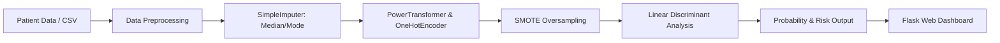

# 🧠 StrokeGuard: AI-Powered Stroke Risk Prediction System

[](https://www.python.org/)
[](https://flask.palletsprojects.com/)
[](https://scikit-learn.org/)
[](https://opensource.org/licenses/MIT)

**StrokeGuard** is an end-to-end Machine Learning web application designed to predict the risk of stroke based on patient clinical and demographic factors. Combining data preprocessing, class-imbalance handling with SMOTE, Linear Discriminant Analysis (LDA), and an interactive web interface built with Flask and Tailwind CSS, StrokeGuard delivers real-time, interpretable risk assessments.

---

## 📌 Project Overview

Stroke is among the leading causes of mortality and long-term disability globally. Early identification of high-risk individuals empowers healthcare professionals and individuals to take proactive, preventative measures.

StrokeGuard implements a complete machine learning lifecycle:
1. **Exploratory Data Analysis (EDA)** on clinical health records.
2. **Robust Data Preprocessing Pipeline** addressing missing values and feature scaling.
3. **Handling Severe Class Imbalance** using SMOTE (Synthetic Minority Over-sampling Technique).
4. **Model Selection**: Training and selecting Linear Discriminant Analysis (LDA) for superior recall and interpretability.
5. **Interactive Web Deployment**: A responsive, modern dashboard powered by Flask and Tailwind CSS.

---

## 🎯 Key Objectives

- Analyze demographic and medical risk factors (e.g., age, glucose levels, hypertension, heart disease).
- Address extreme class imbalance (~5% positive stroke cases) safely via SMOTE inside a cross-validated pipeline.
- Develop an interpretable ML model optimized for high sensitivity / recall (minimizing false negatives in clinical screening).
- Deploy the trained pipeline as a real-time web application accessible on both desktop and mobile browsers.

---

## 📊 Dataset Description

- **Source:** Kaggle – *Healthcare Stroke Dataset*
- **Size:** 5,110 records, 11 clinical features + 1 target
- **Target Variable (`stroke`):** `1` = Stroke observed, `0` = No stroke

### Feature Summary

| Feature | Description | Type |
|---|---|---|
| `gender` | Male, Female, or Other | Categorical |
| `age` | Patient age (in years) | Numerical |
| `hypertension` | Diagnosis of high blood pressure (0 = No, 1 = Yes) | Binary |
| `heart_disease` | Recorded coronary heart disease (0 = No, 1 = Yes) | Binary |
| `ever_married` | Marital status (Yes, No) | Categorical |
| `work_type` | Employment type (Private, Self-employed, Govt_job, children, Never_worked) | Categorical |
| `Residence_type` | Living area (Urban, Rural) | Categorical |
| `avg_glucose_level` | Average blood glucose level (mg/dL) | Numerical |
| `bmi` | Body Mass Index (kg/m²) | Numerical (contains missing values) |
| `smoking_status` | Smoking history (formerly smoked, never smoked, smokes, Unknown) | Categorical |

---

## 🔄 Machine Learning Architecture & Workflow



1. **Numerical Transformer**:
   - `SimpleImputer(strategy='median')`: Imputes missing BMI values without bias from outliers.
   - `PowerTransformer(method='yeo-johnson')`: Stabilizes variance and normalizes skewed features (especially glucose level and age).
2. **Categorical Transformer**:
   - `SimpleImputer(strategy='most_frequent')`: Fills unknown categorical entries.
   - `OneHotEncoder(handle_unknown='ignore')`: Encodes categorical features without introducing artificial ordinality.
3. **Oversampling via SMOTE**:
   - Synthesizes minority stroke cases during training to ensure the model learns discriminating boundaries rather than predicting majority class.
4. **Classifier (LDA)**:
   - Linear Discriminant Analysis maximizes class separability in feature space while remaining computationally efficient and highly interpretable.

---

## 📁 Repository Structure

```
StrokeGuard/
│
├── app.py                             # Flask application backend & prediction route
├── training.py                        # Pipeline assembly, model training & export
├── pipeline.pkl                       # Serialized end-to-end ML pipeline
├── StrokePrediction.ipynb             # Exploratory Data Analysis & experiments
├── healthcare-dataset-stroke-data.csv # Dataset used for training
├── requirements.txt                   # Python package dependencies
├── .gitignore                         # Standard git ignore definitions
├── templates/
│   ├── index.html                     # Primary modern UI with Tailwind CSS
│   ├── index2.html                    # Alternative UI layout
│   └── index2_backup.html             # Backup UI template
└── README.md                          # Project documentation
```

---

## ⚙️ Installation & Quickstart

### 1. Clone the Repository
```bash
git clone https://github.com/bprasad03/StrokeGuard.git
cd StrokeGuard
```

### 2. Set Up a Virtual Environment (Optional but Recommended)
```bash
python -m venv venv
# On Windows:
venv\Scripts\activate
# On Linux/macOS:
source venv/bin/activate
```

### 3. Install Dependencies
```bash
pip install -r requirements.txt
```

### 4. (Optional) Retrain the Model
To re-fit and export the pipeline:
```bash
python training.py
```

### 5. Launch the Web Application
```bash
python app.py
```

Open your browser and navigate to:
```
http://127.0.0.1:5000/
```

---

## 🧪 Model Performance & Clinical Considerations

- **Priority on Recall:** In healthcare screening, missing a high-risk individual (false negative) carries much greater risk than a false positive. SMOTE and LDA balance this trade-off effectively.
- **Continuous Probability Score:** Instead of a binary classification, the web application returns calibrated risk percentages and categorizes outcomes into `Low Risk`, `Medium Risk`, and `High Risk`.

---

## 🛡️ License

This project is open-source and available under the [MIT License](LICENSE).
